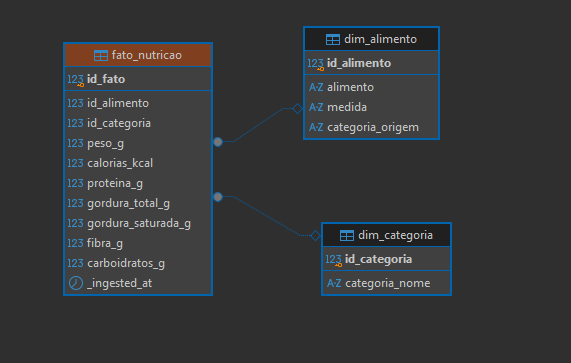

# 🥗 End-to-End Data Engineering Pipeline: Nutritional Facts


-orange.svg)


Este repositório contém o pipeline completo de Engenharia de Dados para ingestão, tratamento, padronização e modelagem dimensional de um dataset sobre informações nutricionais de alimentos. 

O projeto foi construído utilizando a **Arquitetura Medallion** em um ambiente containerizado com **PostgreSQL via Docker**, evoluindo os dados desde o estado bruto até um **Star Schema (Modelo Estrela)** na camada Gold.

---

## 📐 Arquitetura da Solução

O pipeline é organizado em três camadas de maturidade de dados:

 ┌─────────────────┐            ┌─────────────────┐                ┌─────────────────┐       
 │  Bronze (Raw)   │        ──> │ Silver (Cleaned)│  ──────────>   │   Gold (DW)     │  
 └─────────────────┘            └─────────────────┘                └─────────────────┘       
 • Ingestão bruta do CSV        • Padronização em snake_case           • Modelo Dimensional (DW)
  • Fidelidade 100% à fonte       • Limpeza com Regex & Casts            • Tabela Fato (fato_nutricao)
  • Metadados de auditoria        • Tratamento de ruídos ('a', 't')      • Tabelas Dimensão (alimento/cat) 

### 🥉 1. Camada Bronze (`bronze.nutritional_information_raw`)
* **Objetivo:** Armazenar os dados brutos exatamente como vieram da fonte (CSV).
* **Processo:** Cópia fiel mantendo os nomes originais de colunas (ex: `Food`, `Sat.Fat`), adição de metadados de ingestão (`_ingested_at`) e carga via Python utilizando `pandas` e `sqlalchemy`.

### 🥈 2. Camada Silver (`silver.nutritional_information_cleaned`)
* **Objetivo:** Limpeza, padronização e conversão de tipos de dados.
* **Processo:**
  * Renomeação de todas as colunas para o padrão **snake_case** em português (`alimento`, `calorias_kcal`, `proteina_g`, etc.).
  * Sanitização de valores nulos e caracteres inválidos (strings corrompidas como `'a'`, `'t'`, `'?'` ou espaços em branco) usando Expressões Regulares (`Regex`).
  * Remoção de vírgulas de milhar e casting para tipos de dados nativos do PostgreSQL (`NUMERIC`, `INT`, `VARCHAR`).
  * Criação da chave sintética inicial (`id_alimento`).

### 🥇 3. Camada Gold (`gold.dim_categoria`, `gold.dim_alimento`, `gold.fato_nutricao`)
* **Objetivo:** Disponibilizar os dados em um modelo analítico dimensional para consultas rápidas e dashboards.
* **Processo:**
  * **`dim_categoria`:** Extração e desduplicação de categorias usando `UNNEST(STRING_TO_ARRAY(...))` para tratar alimentos com múltiplas categorias associadas.
  * **`dim_alimento`:** Tabela contendo os atributos descritivos do alimento e suas porções.
  * **`fato_nutricao`:** Tabela Fato centralizando as métricas quantitativas (calorias, gramas, proteínas, gorduras, carboidratos e fibras) com **Chaves Estrangeiras (FK)** apontando para as dimensões via `LATERAL UNNEST`.

---

## 🛠️ Tecnologias e Ferramentas

* **Linguagem:** Python 3.11+ (`pandas`, `sqlalchemy`, `psycopg2-binary`, `python-dotenv`)
* **Banco de Dados:** PostgreSQL 16
* **Containerização:** Docker & Docker Compose
* **Linguagem de Transformação:** SQL ANSI / PL/pgSQL
* **IDE / Cliente de BD:** DBeaver / VS Code

---

## 🗄️ Estrutura do Data Warehouse (Star Schema)



## 🚀 Como Executar o Projeto

### Pré-requisitos
* [Docker](https://www.docker.com/) e Docker Compose instalados.
* [Python 3.11+](https://www.python.org/) instalado.
* [DBeaver](https://dbeaver.io/) ou outro cliente SQL para conectar ao PostgreSQL.

### 1. Clonar o repositório
```bash
  git clone https://github.com/Isabelle-Vicente/nutritional_facts.git
  cd SEU_REPOSITORIO
```
### 2. Subir o ambiente PostgreSQL com Docker
```bash
  docker compose up -d
```

### 3. Instalar as dependências Python e Ingerir a Camada Bronze
#### Instalar bibliotecas necessárias
```bash
  pip install requirements.txt
```


#### Executar a ingestão do CSV para a Bronze
```bash
  python ingest_bronze.py
```
### 4. Executar as Transformações SQL (Silver e Gold)
- Conecte seu cliente SQL (ex: DBeaver) ao banco PostgreSQL rodando em localhost:5432.
- Execute os scripts SQL localizados na pasta sql/:
- Execute 01_silver_cleaned.sql para tratar e materializar a camada Silver.
- Execute 02_gold_star_schema.sql para criar o schema gold, as dimensões e a tabela fato.

### 📊 Consulta Exemplo (Camada Gold)
Após a execução completa do pipeline, você pode rodar análises agregadas diretamente na camada Gold:

```bash
  SELECT 
      c.categoria_nome,
      COUNT(DISTINCT f.id_alimento) AS total_alimentos,
      ROUND(AVG(f.calorias_kcal), 2) AS media_calorias,
      ROUND(AVG(f.proteina_g), 2) AS media_proteina_g
  FROM gold.fato_nutricao f
  JOIN gold.dim_alimento a ON f.id_alimento = a.id_alimento
  JOIN gold.dim_categoria c ON f.id_categoria = c.id_categoria
  GROUP BY c.categoria_nome
  ORDER BY media_proteina_g DESC;
```
